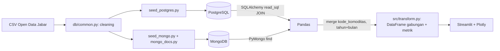

# 🌾 Dashboard Perkembangan Harga Pangan Jawa Barat 2024–2025 (Multi-DBMS Pipeline)

Tugas UTS — Visualisasi Data dan Informasi (Informatika)

**Nama:** Haris Nugraha · **NIM:** 230660121074

🔗 **Live App:** https://harga-pangan-jabar-shujj3s9hf469wnv9zujzg.streamlit.app/
🔗 **Repositori:** https://github.com/febrihariuadi219-dotcom/harga-pangan-jabar

## Studi kasus
Memantau harga bulanan 20 komoditas pangan strategis di Jawa Barat (2024–2025) dan melihat
apakah bulan-bulan dengan peristiwa kalender (Ramadan, Idul Fitri, Idul Adha, Natal/Tahun Baru, Imlek)
berbeda pola harganya dari bulan biasa.

Pemisahan DBMS dipilih karena karakter datanya berbeda:

| DBMS | Engine | Fungsi | Alasan |
|---|---|---|---|
| DBMS 1 | PostgreSQL (Neon/Supabase) | Data master `komoditas` + fakta `harga_bulanan` (terendah/tertinggi/rata-rata) | Data deret waktu terstruktur: FK, CHECK constraint, UNIQUE, JOIN |
| DBMS 2 | MongoDB Atlas | `metadata_komoditas` (kategori, satuan, tags) dan `kalender_peristiwa` (daftar peristiwa per bulan) | Skema fleksibel: jumlah peristiwa tiap bulan berbeda (0, 1, 2, ...) dan atribut bisa bertambah tanpa migrasi |

## Arsitektur & alur pipeline

1. **Cleaning** (`db/common.py`): nama komoditas dibakukan; "Susu Balita (SGM) 400 gram" (2025) disatukan dengan
   "Susu Balita (SGM)" (2024) karena produk yang sama; nilai harga `0` diperlakukan sebagai *tidak tercatat*
   (Minyak Kita Jan–Feb 2024), sehingga 477 dari 479 baris dipakai.
2. **Seed**: harga → PostgreSQL; metadata & kalender → MongoDB.
3. **Integrasi** (`src/transform.py`): hasil query PostgreSQL di-`merge()` dengan koleksi MongoDB
   (kunci `kode_komoditas` dan `tahun`+`kode_bulan`), lalu dihitung metrik turunan:
   perubahan bulan-ke-bulan (MoM %, hanya untuk bulan berurutan) dan rentang harga (% dari rata-rata).
4. Hasil di-cache (`st.cache_data`, TTL 10 menit) lalu divisualisasikan.

## Fitur interaktif
- Filter kategori (dari MongoDB), komoditas, dan tahun; opsi tandai peristiwa kalender
- KPI + tabel harga bulan terakhir per komoditas
- Grafik tren multi-komoditas dengan penanda peristiwa (hover/zoom)
- Pita rentang harga terendah–tertinggi per komoditas (selectbox)
- Heatmap perubahan harga bulanan, bar volatilitas per komoditas, perbandingan bulan peristiwa vs biasa
- Tabel data gabungan + unduh CSV

## Keterbatasan data
- Data **tingkat provinsi** (tidak ada rincian kabupaten/kota), maka tidak ada peta per wilayah.
- Hanya 24 bulan; perbandingan "bulan peristiwa vs biasa" bersifat deskriptif, bukan bukti sebab-akibat.
- Satuan antar komoditas berbeda (kg, liter, item), sehingga nominal tidak langsung sebanding.
- Kategori komoditas dan daftar peristiwa kalender dibuat manual oleh penulis (bukan dari dataset sumber).
  Tanggal peristiwa mengacu pada kalender nasional Indonesia / SKB 3 Menteri tentang hari libur nasional 2024 & 2025.

## Sumber data
- **Dataset:** *Kompilasi Data Perkembangan Harga Pangan di Provinsi Jawa Barat* (ID `od_34418`),
  produsen: Biro Perekonomian Setda Provinsi Jawa Barat, melalui Galura Data Jabar (galura.jabarprov.go.id).
  URL halaman dataset: https://galura.jabarprov.go.id/dataset/kompilasi-data-perkembangan-harga-pangan-di-provinsi-jawa-barat-
- Berkas mentah & metadata: `data/raw/harga_pangan_jabar.csv`, `data/raw/metadata_dataset.pdf`

## Referensi kode / inspirasi
-  https://github.com/credough/iot-predictive-maintenance (dirujuk untuk teknik koneksi Streamlit ke PostgreSQL dengan SQLAlchemy dan struktur pipeline data)
- Streamlit: https://docs.streamlit.io · Plotly: https://plotly.com/python/ · PyMongo: https://pymongo.readthedocs.io

## Struktur repositori
```
app.py                 # UI Streamlit
src/connections.py     # koneksi (secrets/env, tanpa hardcode)
src/queries.py         # query PostgreSQL + MongoDB
src/transform.py       # merge Pandas + metrik
src/charts.py          # grafik Plotly
src/ui.py              # CSS & komponen tampilan dashboard
.streamlit/config.toml # tema gelap
db/schema.sql          # DDL PostgreSQL
db/seed_postgres.py    # seed DBMS 1
db/seed_mongo.py, mongo_docs.py   # seed DBMS 2
data/raw/              # dataset mentah + metadata
```

## Menjalankan lokal
```bash
python -m venv .venv && source .venv/bin/activate   # Windows: .venv\Scripts\activate
pip install -r requirements.txt
cp .env.example .env                                  # isi POSTGRES_URL, MONGO_URI
python -m db.seed_postgres
python -m db.seed_mongo
streamlit run app.py
```

## Deploy (Streamlit Community Cloud)
1. Push ke GitHub (publik); pastikan `.env` tidak ikut.
2. share.streamlit.io → New app → pilih repo & `app.py`.
3. Advanced settings → Secrets → isi seperti `.streamlit/secrets.toml.example`.
4. MongoDB Atlas → Network Access → izinkan `0.0.0.0/0`.
